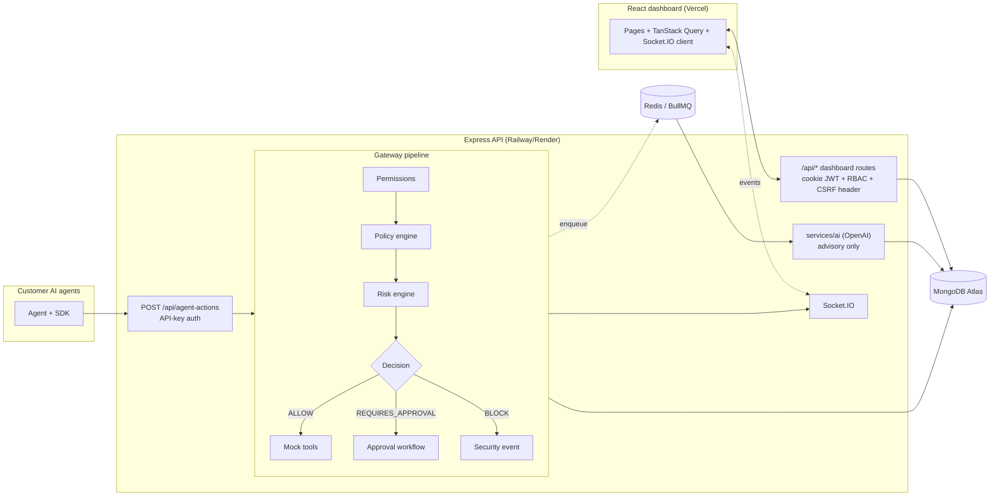

# AgentGuard: Architecture & Roadmap

## 1. Final architecture



**Principles**
- Deterministic rules (permissions, policies, risk) are the enforcement layer; the LLM only annotates (reasoning, injection/DLP signals) and never overrides a BLOCK.
- Every query is scoped by `organizationId` taken from the verified session or API key, never from client input.
- Audit writes are awaited (fail-closed) and the AuditLog model is append-only.
- Slow or non-critical work (AI analysis, anomaly detection, evaluation runs) goes through BullMQ so the gateway stays fast.

## 2. Database schema (MongoDB / Mongoose)

| Collection | Key fields | Indexes |
|---|---|---|
| User | email, name, passwordHash, tokenVersion | email (unique) |
| Organization | name, slug, ownerId | slug (unique) |
| Membership | userId, organizationId, role | (userId, organizationId) unique; (organizationId, role) |
| Agent | organizationId, ownerId, name, status, environment, riskLevel, permissions[], allowedTools[], lastSeenAt | (org, name) unique; (org, status); (org, riskLevel); (org, lastSeenAt desc) |
| ApiKey | organizationId, agentId, prefix, hash, revokedAt, lastUsedAt | prefix (unique); (org, agent, revokedAt) |
| Policy | organizationId, name, actionType, tool?, effect, conditions{maxAmount, allowedAgentIds}, enabled | (org, enabled, actionType) |
| Action | organizationId, agentId, actionType, tool, parameters, riskScore, riskLevel, riskBreakdown[], policyDecision, matchedPolicies[], status, result, timestamp | (org, timestamp desc); (org, agent, timestamp desc); (org, riskLevel, timestamp desc); (org, status, timestamp desc); (org, actionType, timestamp desc) |
| AuditLog | organizationId, actorType, actorId, agentId, action, tool, decision, riskScore, riskLevel, ip, userAgent, metadata, timestamp | (org, timestamp desc); (org, agent, timestamp desc); (org, riskLevel, timestamp desc); (org, action, timestamp desc) |
| *Phase 2+* Tool, Approval, Notification | see spec | (org, status, createdAt desc) etc. |
| *Phase 3+* SecurityEvent | type, severity, status, assignee, notes[], actionId | (org, severity, status, createdAt desc) |
| *Phase 4+* Evaluation, EvaluationRun | testCases[], expected/actual decision, latency | (org, agentId, createdAt desc) |

Indexing rule: every index leads with `organizationId` because every query is tenant-scoped, then the filter/sort column the UI uses.

## 3. API architecture

| Area | Endpoints | Auth |
|---|---|---|
| Auth | `POST /api/auth/register · login · refresh · logout`, `GET /api/auth/me` | none / cookie |
| Agents | `GET/POST /api/agents`, `GET/PATCH /api/agents/:id`, `POST /:id/status`, `POST /:id/rotate-key` | cookie + RBAC |
| Policies | `GET/POST /api/policies`, `GET/PATCH/DELETE /api/policies/:id` | cookie + RBAC |
| Actions (read) | `GET /api/actions`, `GET /api/actions/:id` | cookie + RBAC |
| **Gateway** | `POST /api/agent-actions` | `Bearer agk_...` |
| Audit | `GET /api/audit-logs` (read-only) | cookie + RBAC |
| *P2* | `/api/approvals`, `/api/tools`, Socket.IO namespace `/` | |
| *P3* | `/api/security-events`, `/api/ai/*` | |
| *P4* | `/api/evaluations`, `/api/analytics/*` | |
| *P5* | `/api/docs` (Swagger) | |

Gateway responses: `200` ALLOW, `202` REQUIRES_APPROVAL, `403` BLOCK. All carry a `trace` array (permissions → policy → risk → decision → execution → audit) that powers the Demo page.

Error shape: `{ "error": { "code", "message", "details?" } }`.

## 4. Folder structure

```
agentguard/
├─ client/                    # Vite + React + TS (Phase 2)
├─ sdk/                       # @agentguard/sdk (Phase 5)
├─ docs/
├─ server/
│  ├─ src/
│  │  ├─ config/  controllers/  routes/  models/  middleware/  utils/  types/
│  │  ├─ services/
│  │  │  ├─ auth/  agents/  policies/  risk/  gateway/  audit/     # Phase 1
│  │  │  ├─ approvals/  tools/                                     # Phase 2
│  │  │  └─ ai/                                                    # Phase 3
│  │  ├─ jobs/  queues/  sockets/                                  # Phase 2-4
│  │  ├─ app.ts  server.ts
│  └─ tests/
├─ docker-compose.yml  .env.example  README.md
```

## 5. Roadmap

| Phase | Scope | Status |
|---|---|---|
| 1 | Auth, orgs, RBAC, agents, API keys, gateway, policy + risk engines, audit logs | **built** |
| 2 | Approvals, mock tools, Socket.IO (**server built**); client app shell + dashboard | server done, client next |
| 3 | AI service layer, prompt-injection, DLP, SecurityEvents | **built** (server) |
| 4 | Evaluations, analytics endpoints + charts, Redis/BullMQ, seed script | |
| 5 | SDK, Swagger, integration tests, deployment guide, final README | |
